# System Architecture Analysis
<!-- generated in 0.00s -->

## Overview

- **Project**: /home/tom/github/cliKVM/remotebot
- **Primary Language**: yaml
- **Languages**: yaml: 14, python: 8, shell: 3, txt: 2, yml: 1
- **Analysis Mode**: static
- **Total Functions**: 92
- **Total Classes**: 8
- **Modules**: 31
- **Entry Points**: 82

## Architecture by Module

### automation.remote_automation
- **Functions**: 19
- **Classes**: 3
- **File**: `remote_automation.py`

### automation.live_monitor
- **Functions**: 18
- **File**: `live_monitor.py`

### monitoring_dashboard
- **Functions**: 17
- **Classes**: 2
- **File**: `monitoring_dashboard.py`

### automation.cv_detection
- **Functions**: 14
- **Classes**: 1
- **File**: `cv_detection.py`

### automation.screen_recorder
- **Functions**: 10
- **Classes**: 2
- **File**: `screen_recorder.py`

### automation.automation_cli
- **Functions**: 6
- **File**: `automation_cli.py`

### setup_script
- **Functions**: 4
- **File**: `setup_script.sh`

### automation.run_scenario
- **Functions**: 3
- **File**: `run_scenario.py`

### run_tests
- **Functions**: 1
- **File**: `run_tests.py`

## Key Entry Points

Main execution flows into the system:

### automation.remote_automation.AutomationEngine.execute_dsl
> Wykonuje skrypt DSL
- **Calls**: self.log, self.log, time.sleep, self.recorder.start_recording, step.get, self.log, time.sleep, print

### automation.live_monitor.execute_step
> Execute specific step
- **Calls**: app.route, step.get, automation.live_monitor.add_log, jsonify, jsonify, len, jsonify, automation_engine.execute_dsl

### automation.live_monitor.execute_all
> Execute all steps in scenario
- **Calls**: app.route, Thread, thread.start, jsonify, jsonify, jsonify, jsonify, automation.live_monitor.add_log

### automation.automation_cli.main
- **Calls**: argparse.ArgumentParser, parser.add_argument, parser.add_argument, parser.add_argument, parser.add_argument, parser.add_argument, parser.add_argument, parser.parse_args

### monitoring_dashboard.Monitor.draw_tests_section
> Rysuj sekcję testów
- **Calls**: print, print, self.get_recent_test_results, print, results.get, results.get, results.get, results.get

### automation.run_scenario.main
> Główna funkcja
- **Calls**: argparse.ArgumentParser, parser.add_argument, parser.add_argument, parser.add_argument, parser.add_argument, parser.add_argument, parser.parse_args, automation.run_scenario.run_scenario

### monitoring_dashboard.Monitor.draw_services_section
> Rysuj sekcję usług
- **Calls**: print, print, self.check_vnc_port, print, print, self.check_novnc_port, print, print

### automation.live_monitor.connect_vnc
> Connect to VNC
- **Calls**: app.route, automation.live_monitor.add_log, automation.live_monitor.add_log, RemoteController, live_controller.connect, Thread, thread.start, automation.live_monitor.add_log

### automation.remote_automation.RemoteController.disconnect
> Rozłącza połączenie
- **Calls**: hasattr, hasattr, time.sleep, hasattr, print, self.connection.disconnect, hasattr, self.connection.close

### automation.remote_automation.OllamaVision.analyze_screen
> Analizuje screenshot z promptem
- **Calls**: print, print, self.encode_image, time.time, requests.post, print, time.time, Exception

### automation.screen_recorder.ScreenRecorder.start_recording
> Rozpocznij nagrywanie

Args:
    scenario_name: Nazwa scenariusza testowego
    capture_func: Funkcja zwracająca PIL.Image z aktualnym ekranem
    res
- **Calls**: None.strftime, cv2.VideoWriter, time.time, threading.Thread, self.recording_thread.start, print, RuntimeError, str

### automation.screen_recorder.ScreenRecorder.stop_recording
> Zatrzymaj nagrywanie i zapisz plik

Returns:
    Informacje o nagraniu (plik, czas, klatki)
- **Calls**: print, print, print, print, print, self.recording_thread.join, self.video_writer.release, str

### monitoring_dashboard.Monitor.draw_container_section
> Rysuj sekcję kontenerów
- **Calls**: print, print, self.get_container_status, print, print, print, self.get_container_stats, print

### automation.live_monitor.list_scenarios
> List available scenarios
- **Calls**: app.route, Path, scenarios_dir.glob, jsonify, open, yaml.safe_load, None.keys, print

### automation.live_monitor.get_screenshot
> Get latest screenshot as base64 (deprecated - use /video_feed instead)
- **Calls**: app.route, jsonify, print, traceback.print_exc, None.decode, jsonify, jsonify, len

### automation.remote_automation.RemoteController.key_press
> Naciśnięcie klawisza
- **Calls**: self.connection.keyPress, KeyboardController, print, key.lower, keyboard.press, keyboard.release, keyboard.press, keyboard.release

### monitoring_dashboard.Monitor.draw_header
> Rysuj nagłówek
- **Calls**: print, print, print, print, print, print, datetime.now, None.strftime

### automation.cv_detection.CVDetector.detect_rectangles
> Wykryj prostokąty (okna, dialogi, przyciski)

Args:
    img: Obraz wejściowy
    min_area: Minimalna powierzchnia prostokąta
    
Returns:
    Lista p
- **Calls**: self.detect_edges, cv2.findContours, rectangles.sort, cv2.boundingRect, img.copy, cv2.imwrite, cv2.rectangle, rectangles.append

### automation.remote_automation.OllamaVision.find_element
> Znajduje element na ekranie i zwraca współrzędne
- **Calls**: self.analyze_screen, None.upper, position_map.items, re.search, json.loads, result.get, None.strip, json_match.group

### monitoring_dashboard.Monitor.draw_quick_commands
> Rysuj szybkie komendy
- **Calls**: print, print, print, print, print, print, print, print

### automation.remote_automation.AutomationEngine.__init__
- **Calls**: Path, self.screenshot_dir.mkdir, CVDetector, self.cv_detector.set_debug, ScreenRecorder, print, print, print

### automation.remote_automation.main
> Przykład użycia
- **Calls**: RemoteController, OllamaVision, AutomationEngine, engine.execute_dsl, print, print, traceback.print_exc, config.get

### automation.screen_recorder.ScreenRecorder._recording_loop
> Wątek nagrywający klatki
- **Calls**: time.time, max, time.sleep, self.capture_func, self._pil_to_opencv, time.time, self.video_writer.write, print

### run_tests.main
> Uruchom test suite
- **Calls**: test_suite_path.exists, print, subprocess.run, Path, str, print, print

### monitoring_dashboard.Monitor.display
> Wyświetl pełny dashboard
- **Calls**: self.clear_screen, self.draw_header, self.draw_container_section, self.draw_services_section, self.draw_tests_section, self.draw_quick_commands, self.draw_footer

### monitoring_dashboard.main
> Główna funkcja
- **Calls**: argparse.ArgumentParser, parser.add_argument, parser.add_argument, parser.parse_args, Monitor, monitor.display, monitor.run

### automation.cv_detection.CVDetector.get_screen_diagnostics
> Diagnostyka ekranu - co może być nie tak?

Returns:
    Słownik z diagnostyką
- **Calls**: cv2.cvtColor, np.mean, float, self.is_screen_blank, self.detect_edges, np.sum, int

### automation.cv_detection.CVDetector.quick_analysis
> Szybka analiza obrazu (milisekundy!)

Returns:
    Słownik z wynikami detekcji
- **Calls**: self.get_screen_diagnostics, self.detect_dialog_box, self.detect_buttons, self.find_text_field, self.detect_rectangles, len, self.find_unlock_button

### automation.remote_automation.RemoteController.capture_screen
> Przechwytuje screenshot
- **Calls**: tempfile.NamedTemporaryFile, self.connection.captureScreen, ImageGrab.grab, Image.new, Image.open, img.copy, os.unlink

### automation.remote_automation.AutomationEngine.save_screenshot
> Zapisuje screenshot z timestampem
- **Calls**: None.strftime, screen.save, self.log, str, self.controller.capture_screen, str, datetime.now

## Process Flows

Key execution flows identified:

### Flow 1: execute_dsl
```
execute_dsl [automation.remote_automation.AutomationEngine]
```

### Flow 2: execute_step
```
execute_step [automation.live_monitor]
  └─> add_log
```

### Flow 3: execute_all
```
execute_all [automation.live_monitor]
```

### Flow 4: main
```
main [automation.automation_cli]
```

### Flow 5: draw_tests_section
```
draw_tests_section [monitoring_dashboard.Monitor]
```

### Flow 6: draw_services_section
```
draw_services_section [monitoring_dashboard.Monitor]
```

### Flow 7: connect_vnc
```
connect_vnc [automation.live_monitor]
  └─> add_log
  └─> add_log
```

### Flow 8: disconnect
```
disconnect [automation.remote_automation.RemoteController]
```

### Flow 9: analyze_screen
```
analyze_screen [automation.remote_automation.OllamaVision]
```

### Flow 10: start_recording
```
start_recording [automation.screen_recorder.ScreenRecorder]
```

## Key Classes

### monitoring_dashboard.Monitor
- **Methods**: 16
- **Key Methods**: monitoring_dashboard.Monitor.__init__, monitoring_dashboard.Monitor.clear_screen, monitoring_dashboard.Monitor.get_container_stats, monitoring_dashboard.Monitor.get_container_status, monitoring_dashboard.Monitor.check_vnc_port, monitoring_dashboard.Monitor.check_novnc_port, monitoring_dashboard.Monitor.check_ollama_api, monitoring_dashboard.Monitor.get_recent_test_results, monitoring_dashboard.Monitor.draw_header, monitoring_dashboard.Monitor.draw_container_section

### automation.cv_detection.CVDetector
> Computer Vision detector dla automatyzacji
- **Methods**: 14
- **Key Methods**: automation.cv_detection.CVDetector.__init__, automation.cv_detection.CVDetector.set_debug, automation.cv_detection.CVDetector.screenshot_to_cv, automation.cv_detection.CVDetector.detect_edges, automation.cv_detection.CVDetector.detect_rectangles, automation.cv_detection.CVDetector.find_window_center, automation.cv_detection.CVDetector.detect_buttons, automation.cv_detection.CVDetector.find_text_field, automation.cv_detection.CVDetector.template_match, automation.cv_detection.CVDetector.detect_dialog_box

### automation.remote_automation.RemoteController
> Kontroler dla zdalnych połączeń
- **Methods**: 10
- **Key Methods**: automation.remote_automation.RemoteController.__init__, automation.remote_automation.RemoteController.connect, automation.remote_automation.RemoteController._connect_vnc, automation.remote_automation.RemoteController._connect_rdp, automation.remote_automation.RemoteController._connect_spice, automation.remote_automation.RemoteController.click, automation.remote_automation.RemoteController.type_text, automation.remote_automation.RemoteController.key_press, automation.remote_automation.RemoteController.capture_screen, automation.remote_automation.RemoteController.disconnect

### automation.screen_recorder.ScreenRecorder
> Nagrywa ekran podczas testów automatyzacji
- **Methods**: 6
- **Key Methods**: automation.screen_recorder.ScreenRecorder.__init__, automation.screen_recorder.ScreenRecorder.start_recording, automation.screen_recorder.ScreenRecorder._recording_loop, automation.screen_recorder.ScreenRecorder.stop_recording, automation.screen_recorder.ScreenRecorder._pil_to_opencv, automation.screen_recorder.ScreenRecorder.add_text_overlay

### automation.remote_automation.OllamaVision
> Integracja z Ollama do analizy obrazu
- **Methods**: 4
- **Key Methods**: automation.remote_automation.OllamaVision.__init__, automation.remote_automation.OllamaVision.encode_image, automation.remote_automation.OllamaVision.analyze_screen, automation.remote_automation.OllamaVision.find_element

### automation.remote_automation.AutomationEngine
> Silnik automatyzacji z DSL
- **Methods**: 4
- **Key Methods**: automation.remote_automation.AutomationEngine.__init__, automation.remote_automation.AutomationEngine.log, automation.remote_automation.AutomationEngine.save_screenshot, automation.remote_automation.AutomationEngine.execute_dsl

### automation.screen_recorder.RecordingContext
> Context manager dla wygodnego nagrywania
- **Methods**: 3
- **Key Methods**: automation.screen_recorder.RecordingContext.__init__, automation.screen_recorder.RecordingContext.__enter__, automation.screen_recorder.RecordingContext.__exit__

### monitoring_dashboard.Colors
- **Methods**: 0

## Data Transformation Functions

Key functions that process and transform data:

### automation.remote_automation.OllamaVision.encode_image
> Konwertuje obraz PIL do base64
- **Output to**: io.BytesIO, image.save, None.decode, base64.b64encode, buffered.getvalue

## Behavioral Patterns

### state_machine_RemoteController
- **Type**: state_machine
- **Confidence**: 0.70
- **Functions**: automation.remote_automation.RemoteController.__init__, automation.remote_automation.RemoteController.connect, automation.remote_automation.RemoteController._connect_vnc, automation.remote_automation.RemoteController._connect_rdp, automation.remote_automation.RemoteController._connect_spice

### state_machine_RecordingContext
- **Type**: state_machine
- **Confidence**: 0.70
- **Functions**: automation.screen_recorder.RecordingContext.__init__, automation.screen_recorder.RecordingContext.__enter__, automation.screen_recorder.RecordingContext.__exit__

## Public API Surface

Functions exposed as public API (no underscore prefix):

- `automation.remote_automation.AutomationEngine.execute_dsl` - 137 calls
- `automation.run_scenario.run_scenario` - 47 calls
- `automation.live_monitor.execute_step` - 38 calls
- `automation.automation_cli.run_scenario` - 34 calls
- `automation.live_monitor.execute_all` - 30 calls
- `automation.automation_cli.interactive_mode` - 25 calls
- `automation.automation_cli.main` - 22 calls
- `monitoring_dashboard.Monitor.draw_tests_section` - 17 calls
- `automation.run_scenario.main` - 16 calls
- `monitoring_dashboard.Monitor.draw_services_section` - 15 calls
- `automation.live_monitor.connect_vnc` - 15 calls
- `automation.live_monitor.capture_vnc_screenshot` - 13 calls
- `automation.remote_automation.RemoteController.disconnect` - 13 calls
- `automation.remote_automation.OllamaVision.analyze_screen` - 11 calls
- `automation.screen_recorder.ScreenRecorder.start_recording` - 11 calls
- `automation.screen_recorder.ScreenRecorder.stop_recording` - 11 calls
- `monitoring_dashboard.Monitor.draw_container_section` - 10 calls
- `automation.live_monitor.list_scenarios` - 10 calls
- `automation.live_monitor.get_screenshot` - 10 calls
- `automation.remote_automation.RemoteController.key_press` - 10 calls
- `monitoring_dashboard.Monitor.draw_header` - 9 calls
- `automation.cv_detection.CVDetector.detect_rectangles` - 9 calls
- `automation.remote_automation.OllamaVision.find_element` - 9 calls
- `automation.automation_cli.list_scenarios` - 9 calls
- `monitoring_dashboard.Monitor.draw_quick_commands` - 8 calls
- `automation.remote_automation.main` - 8 calls
- `run_tests.main` - 7 calls
- `monitoring_dashboard.Monitor.display` - 7 calls
- `monitoring_dashboard.main` - 7 calls
- `automation.cv_detection.CVDetector.get_screen_diagnostics` - 7 calls
- `automation.cv_detection.CVDetector.quick_analysis` - 7 calls
- `automation.remote_automation.RemoteController.capture_screen` - 7 calls
- `automation.remote_automation.AutomationEngine.save_screenshot` - 7 calls
- `monitoring_dashboard.Monitor.run` - 6 calls
- `automation.cv_detection.CVDetector.screenshot_to_cv` - 6 calls
- `automation.live_monitor.add_log` - 6 calls
- `monitoring_dashboard.Monitor.get_recent_test_results` - 5 calls
- `automation.cv_detection.CVDetector.find_text_field` - 5 calls
- `automation.live_monitor.load_scenario` - 5 calls
- `automation.live_monitor.load_scenario_api` - 5 calls

## System Interactions

How components interact:

```mermaid
graph TD
    execute_dsl --> log
    execute_dsl --> sleep
    execute_dsl --> start_recording
    execute_dsl --> get
    execute_step --> route
    execute_step --> get
    execute_step --> add_log
    execute_step --> jsonify
    execute_all --> route
    execute_all --> Thread
    execute_all --> start
    execute_all --> jsonify
    main --> ArgumentParser
    main --> add_argument
    draw_tests_section --> print
    draw_tests_section --> get_recent_test_resu
    draw_tests_section --> get
    draw_services_sectio --> print
    draw_services_sectio --> check_vnc_port
    connect_vnc --> route
    connect_vnc --> add_log
    connect_vnc --> RemoteController
    connect_vnc --> connect
    disconnect --> hasattr
    disconnect --> sleep
    disconnect --> print
    analyze_screen --> print
    analyze_screen --> encode_image
    analyze_screen --> time
    analyze_screen --> post
```



## Reverse Engineering Guidelines

1. **Entry Points**: Start analysis from the entry points listed above
2. **Core Logic**: Focus on classes with many methods
3. **Data Flow**: Follow data transformation functions
4. **Process Flows**: Use the flow diagrams for execution paths
5. **API Surface**: Public API functions reveal the interface

## Context for LLM

Maintain the identified architectural patterns and public API surface when suggesting changes.